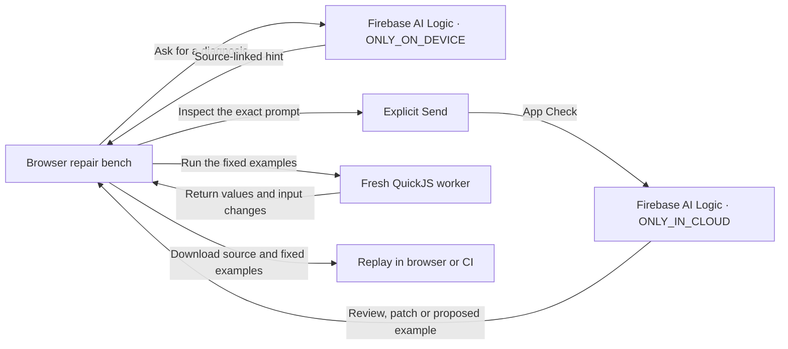

# Local Pit Crew

**Find the test an AI patch missed.**

[Try the checkout repair](https://local-pit-crew.web.app/#checkout-repair). A recorded Gemini patch passes all four original examples. Add one unsafe price to see it fail, review the one-line correction, then save the case as a regression test. The walkthrough runs in your browser without an account or model setup.

[Open the same-score comparison](https://local-pit-crew.web.app/#same-score) to see a patch that fixes one case and breaks another while both versions score 3/4.

To reproduce the missed case from this checkout on Node.js 24 or newer, run:

```sh
npm ci --ignore-scripts --prefix local-pit-crew/runner
npm run replay:function -- examples/checkout/gemini-draft.replay.json --compare-source examples/checkout/shipping-quote.js
```

The command runs the recorded draft and the reviewed correction against the same five synthetic examples. The draft passes 4/5 and the correction passes 5/5. The comparison reports `case-05` as repaired and makes zero model calls.

A repair bench for small JavaScript functions: define what should happen, inspect what actually happened, and check a replacement against the same fixed examples. It makes wrong return values, changed inputs and regressions visible before you call a repair finished. Utility functions, data transforms and validators can be checked directly in the browser.

Gemini Nano through Firebase AI Logic supplies an optional source-linked repair hypothesis. You can request a cloud-proposed replacement, or ask a separate cloud reviewer to challenge a diagnosis. Both cloud actions require reviewing the exact outgoing prompt and explicitly sending it. Model output stays separate from runtime facts; replacements still need diff review, Apply and independent checks. The browser also accepts pasted replacements, and the companion can use a local coding model. Mechanical read/apply/check transitions stay deterministic.

## Try the repair bench

[Open the web demo](https://local-pit-crew.web.app/). **Try a failing function** opens the supplied tag example, checks its baseline and reads the source without a model call. **Bring my function** opens the form for your source and fixed JSON examples. Your form draft is preserved when trying the supplied example. In a supported Chrome browser with its on-device model ready, you can ask Nano about a failure; the separate cloud review works without that native model. Firebase uses its normal App Check provider on the hosted site.

Open a terminal in the repository root. With Node.js 24 or newer, the reference workflow needs no package installation.

To reproduce the hosted browser build locally, follow the [static web build instructions](docs/web-demo.md). They also explain how to enable Firebase inference with your own Firebase project.

```sh
npm start
```

Open the exact `http://127.0.0.1:PORT` printed by the server. Expand **Practice with guided repair drills**, choose a drill and click **Inspect failure** to reproduce its baseline and read the source in one step. Model advice needs a separate action. Inspect the evidence, load the authored correction, apply it in memory, rerun the checks, and finish. **Open reference** retains the manual workflow for stepping through each read and check. All three drills use real HTTP and the persisted controller. Reference corrections are authored examples; no AI produces them. Export a run record to keep its hashes, check results and provenance without source contents or connection tokens.

**View record JSON** displays the same record in the app so you can inspect or copy it when a browser download is unavailable. The preview clears when the run changes.

After your function passes its fixed examples, **Download checked function** requests a JavaScript file containing the exact checked source. It remains available after Finish. The browser verifies the UTF-8 bytes against the current source hash before requesting the download, and **View checked source** offers an in-app fallback. This separate source download does not change your project files; the default run record remains source-free.

A pass can still miss a bug. **Challenge with another example** starts a separate unchecked run using that exact checked source, every existing example and one new input/expected return supplied by you. The original contract stays fixed. Fresh execution can expose a missed failure before you accept the repair; the extended contract must pass every example before Finish becomes available.

**Download replay case** keeps that source, its requirements and fixed examples together in a separate JSON file. Reopen it in the browser with **Reopen a saved replay case → Load replay into form**, then Open and run fresh checks. Loading preserves your active run and imports no old verdict. Alternatively, after installing the pinned runner dependency, `npm run replay:function -- PATH.replay.json` checks the file hashes and reruns the case in a bounded QuickJS Node worker with zero model calls. [Replay instructions and limits](docs/own-function.md).

To carry those regression checks into CI, add `--junit replay-results.xml` to the replay command. It writes a new JUnit report with fixed check IDs and source/contract hashes, excluding private code and example values. An unavailable verifier is reported as an error; it never becomes a fabricated pass or candidate failure. Existing report files are preserved.

Keep the downloaded examples and check your current standalone function file against them with `npm run replay:function -- CASE.replay.json --source src/my-function.js`. The runner verifies the original replay hashes, keeps its contract, and reports the hash of the current file it actually checked.

Capture a failing run with **Download failure replay**, then compare it with the checked repair using `npm run replay:function -- baseline.replay.json --against repaired.replay.json`. Both versions execute afresh under the same byte-identical contract, so a repaired check cannot hide a regression behind an unchanged pass count.

For a model-proposed repair, run the baseline and choose **Review cloud patch request**. The preview reads the current function and contract locally and displays the complete request. **Send patch request to Google** requests a replacement through Firebase AI Logic. You can close and reject the reply without consuming a proposal slot, or choose **Review proposed diff**, inspect the exact change, **Apply in memory**, and verify every fixed example. The browser reports the proposal's cloud origin separately from pasted code. The cloud path works without the on-device model and never silently substitutes for a requested Nano diagnosis.

The pagination drill also offers **Load authored regression trap** after its baseline. This plausible patch fixes zero and empty-string cursors but breaks null and undefined: **4/6 stays 4/6, with different failures**. The bench shows each newly passing and newly failing check, keeps Finish blocked, and requires a separate review and apply for the correction. Check-by-check comparisons also appear for generated repair sessions after the trusted verifier accepts checks for the changed source. The authored challenge makes no model call and does not measure model accuracy.

The [static web build](docs/web-demo.md) runs the authored drills and small user functions in a browser tab. Paste a function and fixed JSON examples, check its actual behavior in a separate worker, review a replacement and verify again. No local service or model download is required for pasted repairs. Firebase model opinions are optional. Actual local coding-model generation and Docker-qualified checks use the companion described below.

## Connect Firebase and a local model

See [Firebase setup](docs/firebase-setup.md) for the browser-only advisor, [local coder setup](docs/local-coder.md) for a real model preview, and [architecture](docs/architecture.md) for the execution boundaries. Public Firebase configuration is supplied explicitly. Connection tokens and development configuration stay out of Git.

### Hosted repair flow



Model replies feed the review interface. Only a fresh check of the current source against the fixed examples can mark a repair as checked. The browser can run the checks, review pasted patches and reopen replays without a Firebase project. Follow the [Firebase setup guide](docs/firebase-setup.md) to enable real inference in your own build.

The [verified coder-only mode](docs/local-coder.md#verify-generated-patches) accepts an Ollama-only configuration. It can generate and verify local-model patches without a Firebase project; the same Docker qualification remains mandatory. Firebase configuration enables the separate Nano and cloud features.

You can [bring your own synchronous JavaScript function](docs/own-function.md) and fixed JSON counterexamples in the web build or qualified companion. Both check return values and input preservation, show repaired and regressed checks, and require review before Apply. The browser uses a bounded QuickJS/WASM interpreter in a fresh worker; it does not claim Docker qualification or kernel resource limits. The companion adds that separately qualified boundary. Optional Firebase advice stays separate from patch execution.

An example explains its failure with the actual input, expected return and observed result. A return can match while the function still changes its caller's data; both conditions are visible. When you request Nano diagnosis for your function, its local prompt includes the failed examples and these observations so it can reason about the observed mismatch. Runtime facts stay separate from the model's suggested cause and are excluded from the source-free evidence export.

```sh
npm ci --ignore-scripts --prefix local-pit-crew/web
npm run build:firebase
npm run start:firebase -- --config /absolute/path/to/browser.local.json
```

In a supported Chrome desktop browser, use **Runtime & setup** to check model readiness. A separate download action is offered when the native model supports it. Once ready, run a failing reference check and read a source file. Then choose **Ask Nano about this failure**. The inference adapter calls Firebase AI Logic with `ONLY_ON_DEVICE`, checks the SDK-reported inference source, and shows a repair hint separately from the authored patch. It does not start model setup or fall back to the cloud. Firebase/App Check initialization can contact Google for setup and attestation.

For a separate second opinion, choose **Review cloud payload**, inspect the full prompt and destination, then **Send this prompt to Google**. The standard request shares the task, displayed source evidence and failed check IDs. If a current Nano hypothesis is available and you want Gemini to critique it, choose **Review second opinion with Nano hypothesis** instead. Both requests use `gemini-3.5-flash-lite` through Firebase AI Logic in `ONLY_IN_CLOUD` mode. Advice never applies a patch or verifies a fix.

The combined on-device hint → explicit cloud review has been exercised on the hosted site in Chrome with real Firebase inference and the normal App Check provider, with debug mode disabled. The SDK reported `on_device` and `in_cloud` respectively. In one retained test, the cloud reviewer challenged an unsafe Nano cursor suggestion. Later tests also found disagreement between its classification and explanation, so the UI presents its reasoning as review notes. This demonstrates the review flow; it does not establish reliable semantic classification, exact Nano generation, traffic locality or an improvement in repair accuracy.

## Validate

```sh
npm test
npm run audit:public -- --tree-only
```

Tests cover controller integrity, patch parsing, provider contracts, deadlines, lifecycle races, safe evidence exports, source/bundle integrity and actual loopback HTTP journeys. Fake-provider tests are explicitly separate from real inference. CI rebuilds the pinned browser bundle and checks it on Windows and Linux.

## Current limits

This is an actively developed hackathon prototype, not a production-qualified coding agent. Source edits stay in memory. The explicit [verified workbench](docs/local-coder.md#verify-generated-patches) builds and qualifies a Docker/QuickJS runner before enabling pagination and settings-isolation public checks. Normal previews and the asynchronous search drill retain closed generated-code verification. Exact required Nano identity, task-traffic locality, hardware resource use and held-out improvement each need separate evidence; passing the software tests does not establish them.

Built for [#BuildHybridAI 2026](https://firebasehybridaihackathon.devpost.com/). [Apache-2.0](LICENSE). See [public release checks](docs/public-release.md) before changing repository visibility.
